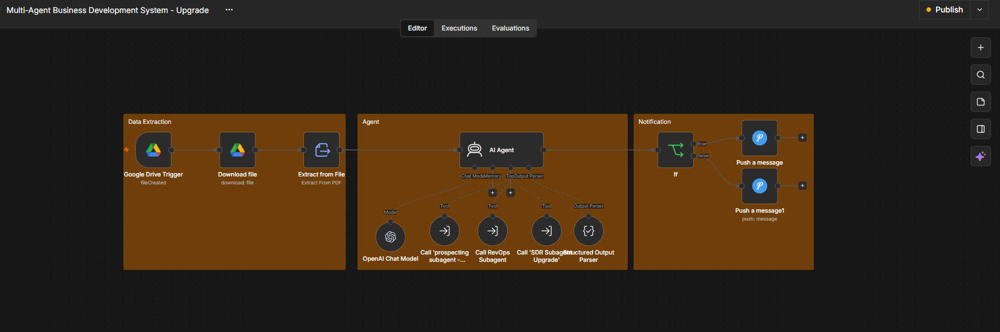
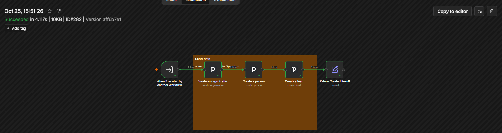
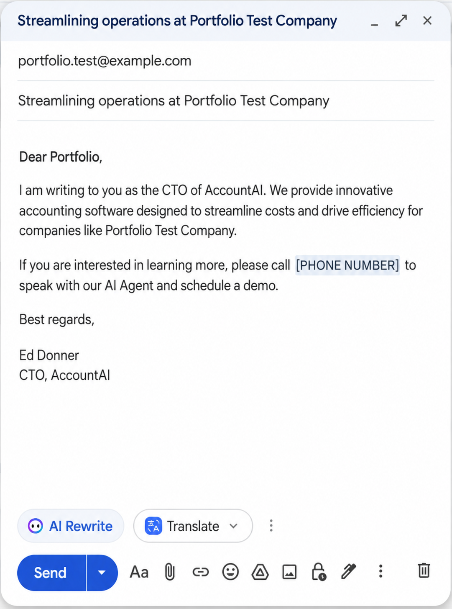
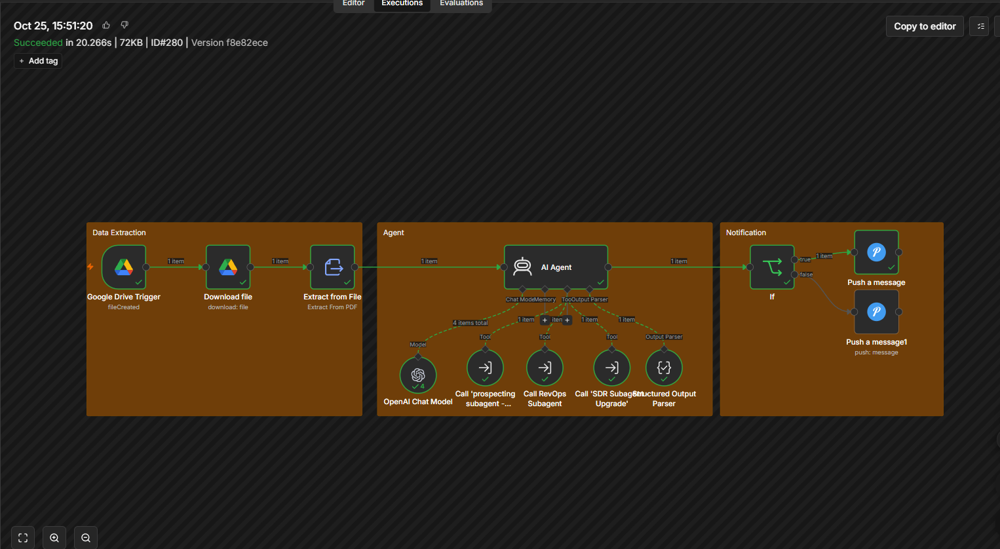
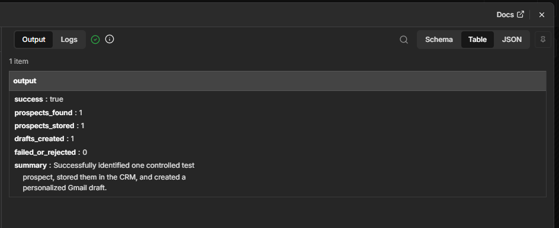

# Multi-Agent Business Development System

An **agentic business development automation system** built with n8n that coordinates specialized AI subagents to process an Ideal Customer Profile (ICP), create CRM records, and generate personalized outbound email drafts.

The project demonstrates how AI agents can be combined with deterministic workflow automation to build a controlled, modular business process.

> **Testing note:** The final end-to-end verification used a controlled prospect fixture so the orchestration, CRM creation, email drafting, structured output, and workflow routing could be tested reliably. Experimental live prospect research components were explored separately and are not presented as part of the final verified execution.

---

## System Architecture

The workflow is organized into three main stages:

**Data Extraction → Agent Orchestration → Result & Notification**



### High-Level Flow

```text
ICP PDF
   ↓
Google Drive Trigger
   ↓
Download File
   ↓
Extract PDF Content
   ↓
Business Development Manager AI Agent
   │
   ├── Prospecting Subagent
   │
   ├── RevOps Subagent
   │      └── Pipedrive CRM
   │
   └── SDR Subagent
          └── Gmail Draft
   ↓
Structured Output
   ↓
Success / Failure Routing
   ↓
Notification
```

The main Business Development Manager agent acts as the orchestrator while specialized subworkflows handle individual business functions.

---

## How It Works

### 1. ICP Intake & Data Extraction

The workflow monitors a Google Drive folder for a new ICP document.

When a PDF is detected, the system:

1. Downloads the file.
2. Extracts its text.
3. Passes the ICP information to the Business Development Manager agent.

This provides the business context used by the orchestration layer.

---

### 2. Business Development Manager Agent

The main AI agent coordinates the business development process.

It follows a bounded sequence:

```text
Prospect
   ↓
Store in CRM
   ↓
Create Outreach Draft
   ↓
Return Structured Result
```

The agent is instructed to call each required subagent only when needed and stop once the required operations are complete.

This helps prevent unnecessary tool loops and repeated actions.

---

## Specialized Subagents

### Prospecting Subagent

The Prospecting Subagent provides prospect information in a structured format:

```text
firstname
lastname
company
role
email
rationale
```

For the final portfolio verification, a **controlled test prospect** was returned by this subworkflow.

This allowed the downstream multi-agent system to be tested independently of external prospect-research availability.

An experimental research architecture using Firecrawl through MCP and professional email discovery was also explored during development, but that live research path was **not part of the final verified end-to-end execution**.

---

### RevOps Subagent

The RevOps Subagent receives structured prospect information and performs deterministic CRM operations in Pipedrive.

It performs the following sequence:

```text
Create Organization
        ↓
Create Person
        ↓
Create Lead
        ↓
Return Created Result
```



Using deterministic workflow nodes for CRM operations avoids unnecessary LLM reasoning where the required business sequence is already known.

---

### SDR Subagent

The SDR Subagent handles personalized outbound email drafting.

It receives only the prospect associated with the current workflow run and uses an AI agent to create one personalized Gmail draft.

The subagent is constrained to:

- Process only the supplied prospect.
- Create exactly one personalized email draft.
- Use only supplied prospect information.
- Avoid inventing prospect or company facts.
- Create a Gmail **draft only**.
- Never automatically send the email.



This creates a human review point before external communication.

---

## Successful End-to-End Execution

The complete controlled workflow successfully executed across the main orchestration and required subagents.



The verified execution completed:

```text
ICP Processing
      ↓
Agent Orchestration
      ↓
Prospect Handoff
      ↓
CRM Creation
      ↓
Personalized Gmail Draft
      ↓
Structured Result
      ↓
Success Routing
```

---

## Verified Results

The final controlled test returned:

| Metric | Result |
|---|---:|
| Prospects found | 1 |
| Prospects stored | 1 |
| Gmail drafts created | 1 |
| Failed or rejected | 0 |
| Overall execution | Successful |



The structured output provides a predictable contract between the AI orchestration layer and the surrounding workflow.

Example:

```json
{
  "success": true,
  "prospects_found": 1,
  "prospects_stored": 1,
  "drafts_created": 1,
  "failed_or_rejected": 0,
  "summary": "Successfully completed the controlled business development run."
}
```

---

## Key Design Decisions

### Structured Agent-to-Agent Data

Prospect information is passed as individual structured fields rather than repeatedly converting structured information into prose and asking another model to reconstruct it.

This reduces ambiguity between workflow components.

### AI for Ambiguity, Deterministic Logic for Certainty

AI is used where language understanding or generation provides value.

Known operations such as CRM record creation and conditional routing remain deterministic.

### Scoped Subagents

Each subagent receives only the information required for its task.

For example, the SDR subagent processes the prospect from the current workflow run rather than retrieving and processing unrelated CRM contacts.

### Human-in-the-Loop Outreach

The system creates Gmail drafts instead of automatically sending outbound emails.

A person therefore remains responsible for reviewing external communication.

### Bounded Agent Behavior

The orchestration prompt defines the required execution order and limits repeated tool calls.

This makes the workflow more controlled than giving the agent unrestricted access to business tools.

### Structured Outputs

The main agent returns predefined fields such as:

- `success`
- `prospects_found`
- `prospects_stored`
- `drafts_created`
- `failed_or_rejected`
- `summary`

This allows downstream automation to make decisions using predictable data.

---

## Technology Stack

| Technology | Purpose |
|---|---|
| n8n | Workflow orchestration and reusable subworkflows |
| AI Agent / LLM | Business process orchestration and outreach generation |
| Google Drive | ICP document intake |
| PDF Extraction | Convert ICP documents into workflow data |
| Pipedrive | Organization, person, and lead creation |
| Gmail | Personalized outbound draft creation |
| n8n Expressions | Structured data mapping between workflow components |
| Structured Output | Reliable AI-to-workflow communication |
| MCP / Firecrawl | Experimental prospect-research architecture |

---

## Workflow Files

The repository contains four sanitized n8n workflow exports:

```text
workflow/
├── business-development-manager.json
├── prospecting-subagent.json
├── revops-subagent.json
└── sdr-subagent.json
```

### `business-development-manager.json`

Main orchestration workflow responsible for ICP processing, subagent coordination, structured results, and success/failure routing.

### `prospecting-subagent.json`

Prospecting component used to provide structured prospect data to the orchestration layer.

### `revops-subagent.json`

Deterministic CRM workflow responsible for creating the organization, person, and lead in Pipedrive.

### `sdr-subagent.json`

AI-assisted outreach workflow responsible for generating a personalized Gmail draft for the supplied prospect.

---

## Repository Structure

```text
multi-agent-business-development/
│
├── README.md
│
├── workflow/
│   ├── business-development-manager.json
│   ├── prospecting-subagent.json
│   ├── revops-subagent.json
│   └── sdr-subagent.json
│
└── screenshots/
    ├── workflow-architecture.png
    ├── successful-execution.png
    ├── final-result.png
    ├── revops-subagent.png
    └── gmail-draft.png
```

---

## Security & Sanitization

All public workflow exports were reviewed before publication.

Sensitive environment-specific information was removed or replaced, including:

- API keys
- OAuth credential references
- Gmail credentials
- Pipedrive credentials
- Firecrawl/MCP authentication information
- Google Drive folder identifiers
- Private webhook identifiers
- n8n instance and workflow metadata

The public workflow files therefore require users to configure their own credentials and environment-specific identifiers.

Private original workflow exports are **not included** in this repository.

---

## Import & Configuration

The JSON files are provided primarily as portfolio/reference exports.

To adapt the system to another n8n environment:

1. Import the four workflow JSON files into n8n.
2. Configure an LLM provider.
3. Configure Google Drive credentials.
4. Configure the ICP Google Drive folder.
5. Configure Pipedrive credentials.
6. Configure Gmail OAuth credentials.
7. Configure the notification integration if required.
8. Reconnect the main workflow to the imported subworkflow IDs.
9. Test each subworkflow independently.
10. Run a controlled end-to-end test before using real business data.

Environment-specific configuration is intentionally excluded from the public repository.

---

## Current Limitations

The final portfolio verification used a controlled prospect fixture.

Therefore, the verified project demonstrates:

- Multi-agent orchestration
- ICP document processing
- Structured prospect handoff
- Pipedrive CRM creation
- AI-generated personalized outreach
- Gmail draft creation
- Structured execution results
- Conditional success/failure routing
- Human-controlled outbound communication

Live prospect discovery through the experimental MCP/Firecrawl research path was **not verified as part of the final successful end-to-end execution** and is therefore not claimed as a completed production capability.

---

## What This Project Demonstrates

This project demonstrates practical AI automation engineering patterns including:

- Multi-agent workflow orchestration
- Reusable specialized subworkflows
- Tool calling
- Structured agent-to-agent communication
- CRM automation
- AI-assisted business communication
- Deterministic workflow boundaries
- Bounded agent autonomy
- Human-in-the-loop design
- Controlled end-to-end testing
- Credential-safe public workflow exports

---

## Project Status

**End-to-End Controlled Test: Passed ✅**

The verified workflow successfully processed an ICP document, coordinated the required subagents, created the prospect in the CRM, generated a personalized Gmail draft, returned structured execution results, and completed the success path.
